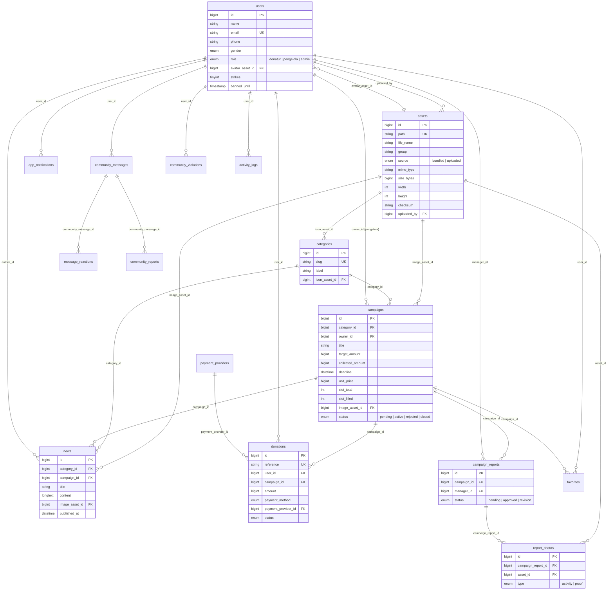

# ERD Database SADAQO

Database: MySQL (`sadaqo`). Dikelola lewat migration Laravel di `backend/database/migrations`.

Prinsip utama: **tabel `assets` adalah registri semua gambar**. Gambar bawaan aplikasi
(`source = bundled`) dan gambar yang diunggah admin/pengelola (`source = uploaded`) sama-sama
tercatat di sana. Tabel lain hanya boleh menunjuk gambar lewat foreign key ke `assets`.



## Query pembuktian (untuk presentasi)

```sql
-- 1) Semua gambar terdaftar, dikelompokkan
SELECT `group`, source, COUNT(*) AS jumlah FROM assets GROUP BY `group`, source;

-- 2) Gambar tiap program lewat foreign key ke assets
SELECT c.title, a.path, a.source
FROM campaigns c JOIN assets a ON a.id = c.image_asset_id;

-- 3) Gambar hasil unggahan admin/pengelola beserta pengunggahnya
SELECT a.path, a.group, u.name AS pengunggah, u.role
FROM assets a JOIN users u ON u.id = a.uploaded_by
WHERE a.source = 'uploaded';

-- 4) Gambar yang belum dipakai tabel mana pun
SELECT a.* FROM assets a
LEFT JOIN campaigns c ON c.image_asset_id = a.id
LEFT JOIN news n ON n.image_asset_id = a.id
LEFT JOIN categories k ON k.icon_asset_id = a.id
LEFT JOIN users u ON u.avatar_asset_id = a.id
LEFT JOIN report_photos r ON r.asset_id = a.id
WHERE c.id IS NULL AND n.id IS NULL AND k.id IS NULL AND u.id IS NULL AND r.id IS NULL;
```
